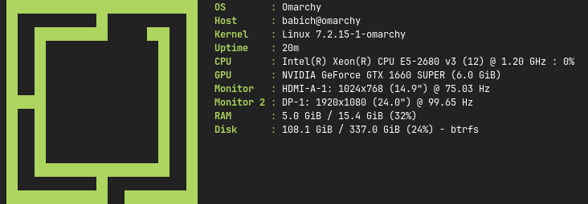

# ferrisfetch

[](https://github.com/babichgh/ferrisfetch/actions/workflows/ci.yml)
[](https://github.com/babichgh/ferrisfetch/releases/latest)
[](https://crates.io/crates/ferrisfetch)
[](https://crates.io/crates/ferrisfetch)
[](LICENSE)

**ferrisfetch** is a [Fastfetch](https://github.com/fastfetch-cli/fastfetch)-inspired
system information tool written in Rust. It displays your system's details next
to an ASCII logo, with selectable modules, automatic colours, and plain-text or
JSON output for scripts

- **531 built-in logos**, vendored from Fastfetch
- **12 system information modules**, shown in the order you choose
- **Terminal-aware layout** that hides the logo when space is limited
- **Script-friendly output** with `--pipe`, `--json`, and automatic colour detection

> Linux is the primary target. Prebuilt RPM and DEB packages target x86-64;
> module availability depends on your hardware and desktop session

## Preview



## Installation

### Cargo

Install the latest published version from [crates.io](https://crates.io/crates/ferrisfetch)
using a recent stable Rust toolchain:

```sh
cargo install ferrisfetch
```

### Linux packages

Download the appropriate package from the
[latest GitHub release](https://github.com/babichgh/ferrisfetch/releases/latest),
then run the corresponding command in your download directory:

| Distribution | Package | Install |
|---|---|---|
| Fedora | `.x86_64.rpm` | `sudo dnf install ./ferrisfetch-*.x86_64.rpm` |
| Debian / Ubuntu | `_amd64.deb` | `sudo apt install ./ferrisfetch_*_amd64.deb` |

Release assets include `checksums.txt` for SHA-256 verification. These are local
package installs; ferrisfetch is not currently advertised as a package in your
distribution's official repositories

## Build from source

With Git and a recent stable Rust toolchain installed:

```sh
git clone https://github.com/babichgh/ferrisfetch.git
cd ferrisfetch
cargo install --path .
```

To build without installing, run `cargo build --release --locked`. The binary
will be at `target/release/ferrisfetch`

## Usage

```sh
# Display system information with your distribution's logo
ferrisfetch

# Choose modules and their order
ferrisfetch --modules os,host,kernel,cpu,ram

# Hide modules from the default output
ferrisfetch --hide-modules gpu,monitor

# Explore the available options
ferrisfetch --help
```

### Available modules

| Module | Information |
|---|---|
| `os` | Operating system / distribution |
| `host` | User and hostname |
| `kernel` | Kernel name and version |
| `uptime` | Time since boot |
| `cpu` | Processor, core count, and frequency (no sampling delay) |
| `cpu-usage` | Sampled processor usage (opt-in; waits 200 ms by default) |
| `gpu` | Detected graphics hardware |
| `monitor` | Active displays, resolution, refresh rate, and size when available |
| `ram` | Used and total memory |
| `disk` | Used and available space, usage percentage, and filesystem type |
| `battery` | Battery charge percentage and charging/discharging/full status when available (opt-in, Linux sysfs) |
| `swap` | Used and total swap, with usage percentage (opt-in; omitted when total swap is zero) |

Unavailable information is omitted rather than displayed as `unknown`

The default output includes all modules except `cpu-usage`, `battery`, and `swap`. To include sampled
usage, select it explicitly:

```sh
ferrisfetch --modules os,host,kernel,uptime,cpu,cpu-usage,gpu,monitor,ram,disk
ferrisfetch --pipe --modules cpu-usage --cpu-usage-interval 500
```

The sampling interval is in milliseconds, with a minimum of 200. It has no effect
when `cpu-usage` is not selected.

**Unreleased output change (after 0.3.1):** `cpu` no longer includes the usage percentage.
Use `cpu-usage` for that value; in JSON it is a separate `cpu_usage` key.

Select batteries and swap explicitly, for example:

```sh
ferrisfetch --pipe --modules battery,ram,swap
ferrisfetch --json --modules battery,swap
```

On Linux, `battery` reads devices of type `Battery` from `/sys/class/power_supply`
without external commands or root. Each available battery has a separate
`Battery <device>` key (for example `Battery BAT0`, or `battery_bat0` in JSON),
sorted lexicographically by sysfs device name. These identifiers do not depend on
how many batteries are present. Values look like `42% (charging)`; percentage or
recognized status can also appear alone. Missing, unreadable, absent, or entirely
invalid batteries are omitted. Other platforms currently omit this module.
No runtime estimate, health, serial number, or temperature is collected.

`swap` uses sysinfo and shares a single memory refresh with `ram` when both are
selected. Values look like `1.0 GiB / 4.0 GiB (25%)`; the JSON key is `swap` with
a string value. If total swap is zero, the entry is omitted (including from JSON),
not shown as `unknown` or `0 / 0`.

### Output for scripts

```sh
ferrisfetch --pipe
ferrisfetch --pipe --modules ram | grep '^RAM:'
ferrisfetch --json
ferrisfetch --json --modules kernel | jq .kernel
```

`--pipe` produces plain `Key: value` lines. `--json` produces a JSON object.
Neither output mode includes the logo or ANSI colour codes

## Customization

ferrisfetch is configured through command-line options; it does not currently
read Fastfetch's JSONC configuration files

```sh
# Find a built-in logo by name
ferrisfetch --logo-list | grep nix

# Override the automatically selected logo
ferrisfetch --logo arch

# Hide the logo or disable colours
ferrisfetch --logo-off
ferrisfetch --no-color

# Use the alternative separator (requires a Nerd Font)
ferrisfetch --nerd-separator
```

The default logo is selected from your distribution's `/etc/os-release` ID.
Key colours follow the logo palette. The logo is automatically hidden if the
terminal is too narrow to fit both columns

Alignment uses Unicode terminal column widths, including wide CJK characters,
combining marks, and emoji sequences. Ambiguous-width characters and Nerd Font
icons are treated as one column; actual rendering can vary by terminal and font.

<details>
<summary>Command-line options</summary>

| Option | Description |
|---|---|
| `-m, --modules <MODULES>` | Show only these modules, in the given order |
| `-u, --hide-modules <MODULES>` | Hide these from the default set |
| `--cpu-usage-interval <MS>` | Sampling interval for `cpu-usage` (minimum/default: 200 ms) |
| `--logo-off` | Drop the logo, print a single column |
| `--logo <LOGO>` | Force a logo by name or alias, or `off` |
| `--logo-list` | List all 531 available logos |
| `--no-color` | Disable ANSI colour |
| `--nerd-separator` | Use the Nerd Font separator instead of `:` |
| `--pipe` | Plain `Key: value` output for scripts |
| `--json` | JSON object output |
| `-h, --help` | Show help |
| `-V, --version` | Show the installed version |

</details>

## FAQ

### Is this Fastfetch rewritten in Rust?

No. ferrisfetch is an independent, smaller implementation inspired by Fastfetch,
not a feature-complete port or a drop-in replacement. The ASCII logos are
vendored from Fastfetch and retain their original MIT attribution

### Why is a module missing from the output?

Modules are only shown when their data is available. GPU detection tries
`nvidia-smi`, then `lspci`, then `/sys/class/drm`. Monitor detection queries
Hyprland or XRandR, so it may be unavailable in other sessions or on a headless
machine

### Does a normal run wait for a CPU usage sample?

No. The `cpu` module reads processor information without waiting. Only the
optional `cpu-usage` module samples usage twice, 200 ms apart by default:

```sh
ferrisfetch --modules cpu,cpu-usage
```

### Why are colours missing when I redirect output?

Colour is disabled when stdout is not a terminal, when `NO_COLOR` is set, or
when `--no-color` is passed. This keeps redirected output free of escape codes

### Can I use a custom image or an external logo file?

Currently, `--logo` selects a built-in ASCII logo by name or alias. External
logo files and image protocols are not supported

### What happens if an external tool hangs?

External detection commands have a two-second timeout and a 1 MiB limit on each
of stdout and stderr. Missing, failing, or over-limit commands are skipped in
favour of the next backend. Commands run with the `C` locale and stdin disconnected
from the terminal. On Unix, cleanup also terminates their process group.

### Where can I report a bug or suggest a feature?

Open an [issue](https://github.com/babichgh/ferrisfetch/issues), including your
ferrisfetch version, distribution, command, and expected versus actual output

## Development

```sh
cargo test --locked
cargo clippy --locked --all-targets -- -D warnings
cargo fmt --check
python3 tools/generate_logos.py --check
```

One integration test renders all 531 built-in logos. Artwork lives in [`logos/`](logos),
with metadata in `logos/meta.json`; regenerate the committed Rust table with
`python3 tools/generate_logos.py` after changing those inputs

Contributions are welcome. Target `dev` for development and fixes; `main` is
reserved for releases

<details>
<summary>Release process and Trusted Publishing setup</summary>


Develop on `dev`, bump the version in `Cargo.toml` and `Cargo.lock`, then merge
into `main`. The release workflow validates the code, builds RPM/DEB packages,
publishes to crates.io, and creates the matching GitHub release. Reruns skip
crate versions already published to crates.io

Publishing uses crates.io Trusted Publishing, not a stored API token. In the
crate's settings on crates.io, add a GitHub trusted publisher with:

- Owner: `babichgh`
- Repository: `ferrisfetch`
- Workflow filename: `release.yml`
- Environment: leave empty (the workflow does not use a GitHub environment)

Configure this before pushing a new release to `main`

</details>

## Acknowledgements

- [Fastfetch](https://github.com/fastfetch-cli/fastfetch) for the inspiration and
  the vendored ASCII logo collection
- [sysinfo](https://github.com/GuillaumeGomez/sysinfo) for system information
  collection

## License

MIT. Logo artwork is © fastfetch contributors, also MIT, bundled under
`LICENSE-fastfetch`
